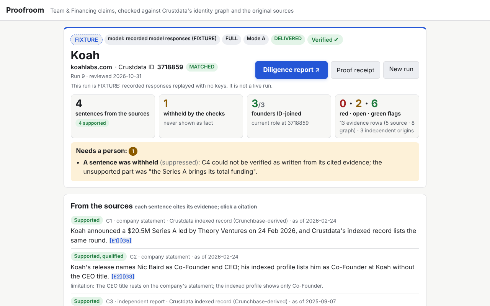
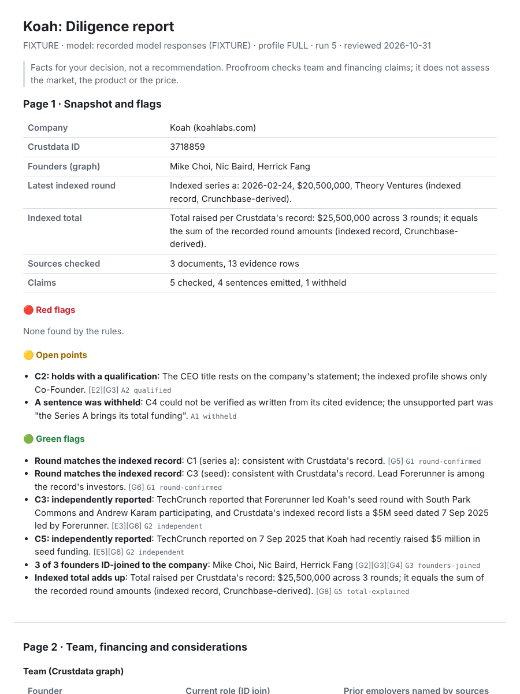

# Proofroom

**Type a startup's name or domain. Get the pre-meeting investment check a VC associate does by hand: who the founders are and whether their story holds up, how much was raised and from whom, how fast the company is growing, what it probably earns, and a rules-based INVEST / ACCUMULATE / HOLD / AVOID signal. Every number cites where it came from, and everything the evidence cannot settle is handed to a person.**

ContextCon 03 · IIT Bombay · 31 Oct 2026 · Theme: **Investing** · *Services, Replaced*

- 2-minute Loom (a company it has never seen, first run): ‹link added at submission›
- Raw unedited recording: ‹link›





**Contents:**

1. [The service](#1-the-service)
2. [What it does now](#2-what-it-does-now-end-to-end)
3. [The hardest cases](#3-the-hardest-cases-and-how-it-handles-them)
4. [How we know it works](#4-how-we-know-it-works)
5. [How to run it](#5-how-to-run-it)
6. [How it is built](#6-how-it-is-built)
7. [Approaches tried](#7-the-approaches-we-tried)
8. [What it could do next](#8-what-it-could-do-next-and-why-not-now)
9. [Limitations](#9-limitations)
10. [The unseen-run protocol](#10-the-unseen-run-protocol-for-the-video)

---

## 1. The service

**The job.** Before every founder meeting, an analyst or associate at a fund works through the same checklist by hand:

- Who are the founders, and did they really work where the deck says?
- How much was raised, when, and who led the round?
- Is the company actually growing (team, traffic, followers), and roughly what does it earn?
- Is the market crowded, and is anything here a red flag?
- In short: is it worth a meeting, and how big a cheque?

It takes about an hour of open tabs per company: the company blog, the lead investor's post, news coverage, professional profiles, a funding database and a traffic tool.

**Who does it today, and who pays.**

- **Who does it:** VC analysts and associates, diligence firms, angel-syndicate leads and corporate-development teams.
- **Who pays:** funds, in three ways:
  - associate time;
  - diligence-vendor fees;
  - database seats that still need a person to reconcile what they show.

It is paid for as an **outcome** (a screened company and a meeting memo), not as a tool.

**Why we picked it.**

- It is a whole service job that sits squarely on data about people and companies, which is what Crustdata's identity graph is.
- It has a clear finished product: a memo a partner can act on.
- The exceptions that genuinely need a person (identity ties, sources that disagree, questions for the founder) are easy to name, so the agent can do the rest.

**Why it is hard, and why a summarizing chatbot gets it wrong:**

- A funding announcement is the company's own statement. The lead investor's post about the same round is **not** a second, independent confirmation.
- News sites copy each other, re-date old stories, and report one round in several currencies.
- Profiles are self-maintained, and "the founders worked at A, B and C" is often true for only one of them.
- A round, a total, a valuation and a sale of existing shares (a tender) are easy to mix up. Crustdata's own `total_investment_usd` for Linear (**$233.2M**) includes a **$99M tender**, which is liquidity for shareholders, not capital for the company.
- Private-company revenue is not public. Database revenue bands are self-reported size buckets that go stale fast: Linear is listed at $10–20M.

A chatbot that searches and summarizes repeats the press release, which is exactly what the investor is trying to check.

## 2. What it does now (end to end)

There are two connected parts. Both start from a request with nothing but a company name or domain.

### 2a. The investment signal: the `/demo` dashboard and the PDF report

**Input:** type a company name or domain. Recorded companies replay instantly at 0 credits. Any other company is identified live in Crustdata and analysed the same way.

**What it does:**

| Step | What happens | Crustdata |
|---|---|---|
| Identify | Name or domain → one company ID | `/company/identify` |
| Growth | Headcount, web visitors and followers over time, plus job postings and engineering share | `/company/enrich` |
| Team & talent | Founders, their schools and prior employers, tiered by home market (IIT/IISc/IIM/BITS for India; Ivy/Stanford/MIT/Oxbridge elsewhere). Staff share from elite schools and ex-big-tech, with namesake profiles filtered out | `/company/enrich`, `/person/search` (counts only) |
| Money | Primary capital vs. secondary sales (type-matched rounds); loaded payroll from headcount × location × role salary benchmarks; a **revenue estimate** with a range and its drivers | `/company/enrich`, `/company/search` (training set) |
| Market | Category, funded peers in the last 24 months (crowding), and growth vs. the peer median | `/company/search` |
| Score | 5 pillars, each 0–100 with its reasons: Team 25%, Traction 30%, Market 15%, Financing 15%, Verification 15%. Critical / red / amber / green flags from **fixed published rules** in `scoring.py` | none (no model) |
| Signal | **INVEST** (≥70) / **ACCUMULATE** (≥58) / **HOLD** (≥45) / **AVOID**. Critical and red flags cap the rating. A suggested allocation of the reader's standard check (default $100K) is scaled by confidence | none |
| Deliver | Interactive dashboard with "how is this scored?" explainers on every number, plus a downloadable multi-page **PDF equity-research report** | none |

The signal is computed by code from published rules, so every point of the score traces to an input. It is labelled a rules-based signal, **not financial advice**.

### 2b. The claims check: the cited brief, via the CLI and `/`

**Input:** a domain (Mode A). Optionally: pasted text or URLs (Mode B), one sentence to check, or a focus note.

| Stage | What happens | Where Crustdata is used |
|---|---|---|
| 1 Identity | The domain resolves to **one** company ID. The exact primary domain wins; a tie abstains and goes to a person | `POST /company/identify` |
| 2 Graph | **In parallel:** the company record (founders with employment IDs, funding milestones, news index) and a founder search (title `founder` OR `cofounder`), merged. People found only by the search are enriched | `/company/enrich` ∥ `/person/search`, then `/person/enrich` |
| 3 Packet | The funding announcement and coverage are picked from Crustdata's news index, using a ±7-day rule around recorded round dates and one source per publisher, then fetched in one request. Text addressed to AI agents is counted and ignored | `/web/enrich/live` (`/web/search/live` as fallback) |
| 4 Claims | The model picks up to 5 material Team & Financing claims, each **quoted verbatim**; code checks every quote against the page | — |
| 5 Joins | Lead investors and named prior employers are resolved by name. Prior employers are joined to each person **by employer ID** (✔), by a **labelled name match** (≈), or not at all (?) | `/company/identify` (names, free) |
| 6 Assess | Each claim gets a status (Supported / Supported, corrected / Conflicting / Not established) and a basis (company statement, investor statement, independent report, indexed record, calculation) | — |
| 7 Gate | **Code** checks every amount, percentage, year and date against the evidence the sentence cites. A **separate check** confirms each sentence is entailed by *only* its cited evidence. A failure drops the clause or withholds the sentence. There is no "repair" call | — |
| 8 Deliver | `brief.md`, `case.json`, `questions.md`, `report.md` and `report.html` are written once, read back, and SHA-256-hashed into `manifest.json` | — |

**Outputs:**

- **Cited brief.** Every sentence carries citations:
  - [E#] for a source passage;
  - [G#] for a Crustdata JSON path.

  It also has the founder table, the funding cross-check, "Not checked", "Limitations", and the evidence list with four clocks: published, updated, provider refresh and retrieved.
- **"Needs a person: N"** at the top of every brief: identity ties, conflicting sources, withheld sentences and failed sources.
- **Founder-meeting ask sheet** (`questions.md`): ranked questions, each with its evidence lines.
- **Proof receipt.** `python -m proofroom verify <run folder>` re-hashes the files and re-checks every number against the stored evidence, offline and with no keys.
- Optional **founder email draft** (`--email`): a draft only, never sent. Per the event rules, agents contact only our own team.

A verified claims check feeds the **Verification** pillar of the signal. A company without one scores a neutral 50 there, its confidence is capped at medium, and it is marked *unverified*.

### Where a person is still needed

- a genuine identity tie (two companies with the same claim to a domain or name);
- sources that disagree on a round, a date or a role;
- sentences the gate withheld;
- the questions only the founder can answer (the ask sheet);
- the final investment decision. Proofroom sizes a signal; a partner decides.

## 3. The hardest cases, and how it handles them

| Case | What goes wrong naively | What Proofroom does |
|---|---|---|
| **Collective claims** (Koah) | Theory Ventures' post says the founders "overlapped at Affirm, Supermove and Qualified", and a summarizer repeats it | In Crustdata's profiles only **Herrick Fang** lists those employers: Affirm 632082 ✔, Supermove 780882 ✔, Qualified ≈ 632707. Proofroom keeps the claim collective and reports it as a scope correction, not a refutation |
| **Totals that include a tender** (Linear) | "Raised $233.2M" | The $99M tender is shown as liquidity, not capital. The non-secondary rounds sum to $134.2M (a labelled calculation), which matches Tracxn's "$134M over 4 rounds" |
| **Founders missing from the record** (Linear) | The CEO is absent from `people.founders` | The founder search always runs in parallel, so it finds Karri Saarinen ("CEO, Cofounder") |
| **Namesake prior employers** | Identify("Qualified") returns 25 companies, and none is the right one | A clearly labelled name-match fallback (≈) that is never counted as an ID join |
| **Inflated headcount** (Clay, Ramp, Mercury) | Namesake profiles inflate staff counts, and per-employee numbers go wrong | The namesake check flags the headcount ⚠️, excludes it from revenue benchmarks, and says so on the page |
| **Stale revenue bands** | "Linear earns $10–20M" | The band is treated as stale when headcount has outgrown it, and the estimate shows its drivers and range instead |
| **Prompt injection in fetched pages** | Text aimed at AI agents changes the output | Fetched text is data, never instructions. Agent-addressed text is counted (the injection meter) and ignored |
| **Tools that fail** | One API error crashes the run | All three of Crustdata's error shapes are normalized; 429s wait for the reset; failed attempts are kept and shown; a missing source becomes "Needs a person", not a guess |

## 4. How we know it works

### Claims check on the development companies

These cases were seen during the build. The unseen company is in the video.

| Company | Status | Sentences emitted / withheld | Founders ID-joined | Key findings | Errors |
|---|---|---|---|---|---|
| **Koah** (koahlabs.com) | DELIVERED · RECEIPT OK | 4 / 1 | 3 of 3 | $20.5M Series A led by Theory ✔ record; Forerunner seed ✔ (TechCrunch + record); the CEO title rests on the company's word only; the release's "more than $26 million" exceeds the indexed $25.5M, so it asks how big the 2024 pre-seed was | 0 |
| **Linear** (linear.app) | DELIVERED · RECEIPT OK | 3 / 2 | 3 of 3 (incl. the CEO, found only by the founder search) | $82M Series C ✔ record; **$99M tender shown as liquidity, not capital**; the $233.2M total is flagged "not capital raised" | 0 |
| **Attio** (attio.com) | DELIVERED · RECEIPT OK | 5 / 0 | 2 of 2 | $52M Series B led by GV ✔ (GV = Google Ventures **only because the release says so**); "$116 million to date" consistent with the record | 0 |

"Errors" counts false conflicts, false sums, wrong subjects, totals presented as capital, and alias errors. Our usefulness bar was at least 3 reusable sentences and at least 1 ID join per company: **3 of 3 pass.**

### Investment signal on 9 companies (replay of recorded Crustdata data, as of 31 Oct 2026)

| Company | Signal | Score | Est. revenue (range) | Red flags |
|---|---|---|---|---|
| Koah | **INVEST** | 82 | $0.51M ($0.44–0.59M) | none |
| Clay | **INVEST** | 80 | $300M ($258–348M) ⚠️ | none |
| Attio | **INVEST** | 75 | $45.9M ($39.5–53.3M) | none |
| Mercury | **INVEST** | 74 | $685M ($590–795M) ⚠️ | none |
| Linear | **ACCUMULATE** | 71 | $81.4M ($70.1–94.5M) | crowded market (126 funded peers in 24 months) |
| TerraStack | **ACCUMULATE** | 65 | $0.42M ($0.36–0.49M) | team shrinking; slower than peers |
| Ramp | **ACCUMULATE** | 59 | $1.82B ($1.57–2.12B) ⚠️ | team shrinking; slower than peers |
| Vercel | **HOLD** | 56 | $451M ($388–524M) | crowded market |
| Retool | **HOLD** | 51 | $129M ($111–150M) | team shrinking; funding stale (51 months) |

⚠️ marks a headcount inflated by namesake profiles, so its revenue estimate is less reliable. Linear scores 71, above the INVEST line, but its red flag caps the rating at ACCUMULATE: the rule is working as designed.

### Revenue estimate accuracy

The estimates are scored against publicly reported revenue or ARR. The method is leave-one-out: a company's own figure is never used to estimate it.

| Estimator | Median error | Within 2x |
|---|---|---|
| Crustdata band midpoint | 78% | 17% |
| Band-trained regression (v1) | 57% | 33% |
| **Chosen pipeline** (Tobit + bias correction, blended with a revenue-per-employee benchmark, plus guardrails) | **14%** | **100%** |

This rests on only 6 reported companies (3 without namesake flags), so treat it as indicative. Every revenue figure is labelled an ESTIMATE. Details:

- [docs/revenue_models_comparison.md](docs/revenue_models_comparison.md): the bake-off of 8 model families;
- [docs/revenue_evaluation.md](docs/revenue_evaluation.md): the evaluation against reported revenue.

### Tests

`pytest -q` gives **311 passed, 1 skipped**, offline, with no keys.

| Group | Files | Tests |
|---|---|---|
| Crustdata adapter: error shapes, retries, cache, fixture mode | `test_errors.py` | 33 |
| Identity and financing joins (G1–G4) on the recorded Koah fixture | `test_graph_koah.py` | 31 |
| Gate: amounts, currencies, precision, dates, clause drop | `test_gate.py` | 36 |
| Packet: dates, relative anchoring, picks, injection meter | `test_packet.py` | 23 |
| Model layer: providers, local validation, refusal and max_tokens | `test_llm.py` | 19 |
| Render, receipt, report, exception desk | `test_render.py`, `test_report.py`, `test_exceptions.py` | 25 |
| Store: write-once, read-back, tamper detection | `test_store.py` | 11 |
| Signals, scoring, talent | `test_signals.py`, `test_scoring.py`, `test_talent.py` | 39 |
| Economics and revenue models | `test_economics.py`, `test_calibration.py`, `test_revenue_model_2.py`, `test_revenue_model_3.py`, `test_revenue_models_alt.py` | 58 |
| Equity-research report | `test_equity_report.py` | 10 |
| Web UI | `test_web.py` | 23 |
| Pipeline helpers | `test_pipeline_helpers.py` | 4 |

### Timing and cost

- Live retrieval for the claims check (identity + graph + packet) takes 6–11 s.
- A replayed demo company loads in under a second.
- In the recorded development runs, most wall-clock time was the agent session answering the three model calls (81–200 s).
- **Cost:** about 5 Crustdata credits per claims check. Replaying a recorded company costs 0.

## 5. How to run it

You need **Python 3.12+**. Node.js is optional; it is used only for the PDF download.

**One command** (Linux, macOS, or Git Bash on Windows). It creates `.venv`, installs pinned dependencies, creates `.env`, and opens <http://localhost:8000/demo>:

```bash
./run.sh
```

**By hand:**

```bash
python3.12 -m venv .venv && .venv/bin/pip install -r requirements.txt
cp .env.example .env            # set CRUSTDATA_API_KEY for live search of new companies
.venv/bin/uvicorn proofroom.web:app --port 8000
```

On **Windows**, use `.venv\Scripts\python.exe` in place of `.venv/bin/python`.

**What to open:**

- <http://localhost:8000/demo>: the investment-signal dashboard. Pick one of the 9 recorded companies (no key needed) or type any company (needs `CRUSTDATA_API_KEY`).
- <http://localhost:8000/>: the claims check. It has a form, the "Load demo case (no keys)" selector, live progress, an evidence drawer behind every citation, and the report.

**From the command line:**

```bash
.venv/bin/python -m proofroom run --fixture koah                                    # replay, no keys, labelled FIXTURE
.venv/bin/python -m proofroom run --domain koahlabs.com --mode LIVE                 # Mode A, domain only
.venv/bin/python -m proofroom run --domain koahlabs.com --fast                      # FAST profile
.venv/bin/python -m proofroom run --domain koahlabs.com --sentence "Koah raised a \$20.5M Series A led by Theory Ventures"
.venv/bin/python -m proofroom verify data/cases/koahlabs-com/run-1                   # proof receipt
.venv/bin/python -m pytest -q                                                       # tests, offline
```

**Model provider.**

- **With `ANTHROPIC_API_KEY` set,** the three calls go to `claude-sonnet-5-5` through the official SDK.
- **Without it** (how we ran it at the event), an agent session acts as the model:
  1. Each call is written to `data/cases/<case>/run-<n>/model/<call>.request.json`, with the system prompt, user message and JSON schema.
  2. A Claude Code session answers it in `<call>.response.json`.
  3. Code validates the answer against the same strict schema.

**Labels.** Every run is labelled LIVE, CACHED, FIXTURE or REPLAY, with its model source and profile. Cached or replayed output is never shown as live.

## 6. How it is built

**Shape:** a pipeline of deterministic code plus three narrow model calls, not a free-roaming agent. Code does everything that can be checked. The model does only what needs reading: picking claims, assessing them, and checking entailment.

- **Stack:**
  - Python 3.12+, async `httpx`, Pydantic v2;
  - FastAPI with Jinja2 and vanilla JS (Chart.js for the dashboard);
  - BeautifulSoup and numpy;
  - headless Chromium (Playwright) for the PDF.

  It uses files only: no database, queue or agent framework.
- **Model:** `claude-sonnet-5-5` via the official `anthropic` SDK, or a Claude Code session through request files.
  - Settings: adaptive thinking; strict Pydantic schemas via `messages.parse()`; no sampling overrides; `max_retries=0` with deadline-derived timeouts.
  - A `max_tokens` stop or a refusal counts as a failed attempt and is kept.
- **Model calls** (`llm.py`, `prompts.py`):
  - **extract:** pick claims and quote them verbatim;
  - **assess:** status and basis for each claim;
  - **check:** is each sentence entailed by only its evidence?
- **Crustdata adapter** (`crustdata.py`):
  - a per-endpoint rolling rate limiter;
  - a development cache keyed by (endpoint, body hash, API version);
  - a normalizer for all three documented error shapes plus non-JSON bodies;
  - retry rules: a 429 waits for the reset, up to 3 tries; one retry on 5xx and network errors; never on other 4xx.

  It records `x-credits-used` on every attempt and keeps failed attempts.
- **Claims check:**
  - `graph.py`: identity, team matrix, ID joins, round checks;
  - `packet.py`: news picks, dates, the injection meter;
  - `gate.py`: the deterministic number and date gate;
  - `render.py` and `report.py`: brief, ask sheet and report;
  - `exceptions.py`: "Needs a person";
  - `verify.py`: the proof receipt;
  - `store.py`: write-once files and the SHA-256 manifest;
  - `pipeline.py`: the orchestrator, which runs independent stages concurrently.
- **Investment signal:**
  - `signals.py`: growth, market, peers and crowding;
  - `talent.py`: founder schools, elite-alumni and ex-big-tech counts;
  - `economics.py`: payroll by location × role, plus the customer profile;
  - `revenue_models_alt.py`, with the trained parameters in `proofroom/data/`: the revenue estimate;
  - `scoring.py`: flags, pillars, rating and sizing;
  - `equity_report.py`: the PDF;
  - `demo.py`: the `/demo` backend.

**Where it calls Crustdata, and why:**

| Endpoint | Why |
|---|---|
| `POST /company/identify` (domain or name) | The subject anchor: everything is about one company ID |
| `POST /company/identify` (names) | Lead investors and prior employers, resolved to IDs for joins (free) |
| `POST /company/enrich` | One call for founders with employer IDs, funding milestones, investors, news, and the headcount, traffic and follower series |
| `POST /company/search` | Funded peers in the same category (crowding, peer growth), and the 126-company revenue training set |
| `POST /person/search` | Founder discovery, merged with the record (it found Linear's CEO, whom the record omits); talent counts (`limit 1`, read `total_count`) |
| `POST /person/enrich` | Employment history for people the record does not list |
| `POST /web/enrich/live` | The source pages themselves (raw HTML, matched by URL) |
| `POST /web/search/live` | Fallback when the news index has no funding article |

The Crustdata MCP server was used only to probe data shapes during development. The product calls the REST API (`x-api-version: 2025-11-01`) for typed responses, credit headers and documented fetch output.

## 7. The approaches we tried

| Approach | Outcome |
|---|---|
| Person Search, then Person Enrich, as the main graph path | **Replaced.** One Company Enrich call returns founders *with* employer IDs plus funding and news for 2 credits. The search now runs *in parallel* and is merged |
| Founder search only when the record lists no founders | **Failed on Linear.** It missed the CEO ("CEO, Cofounder"), so the search always runs, with a `founder OR cofounder` title filter |
| Strict ID-only prior-employer joins | **Too strict.** Identify("Qualified") returns 25 namesakes and none is the right company. We added a clearly labelled name-match fallback (≈) that is never counted as an ID join |
| Using `total_investment_usd` as "total raised" | **Wrong for Linear:** it includes a $99M tender. Rounds are now type-matched, and the total is shown as capital only when no secondary sale exists |
| Trusting `news[]` order and dates | **Noisy:** it had namesakes, a `1970-01-01` sentinel date, and re-dated pages. The ±7-day rule around recorded rounds plus one source per publisher fixed it |
| Short (220-character) evidence excerpts | **Caused false withholds:** attributions such as "said in a blog post" were cut off. Excerpts are now sentence-complete |
| Asking the model to fix sentences that fail checks | **Rejected by design.** That is the "summarize and hope" failure mode. Failing clauses are dropped or the sentence is withheld, with a reason |
| A model-written invest/pass verdict | **Rejected.** A model verdict cannot be traced. The signal we ship comes from fixed, published rules in code, so each point of the score traces to an input |
| Using Crustdata's revenue band as the revenue | **Wrong by 4–9×** for fast growers (it is a stale self-reported bucket). It is replaced by an estimate validated on reported revenue |
| 8 revenue model families (ridge, Huber, Tobit, kNN, boosted trees, segment, stack, social-post features) | The model family mattered far less than **correcting the model's known low bias** and blending with a revenue-per-employee benchmark. Social-post features (model 2) helped a little in cross-validation, not significantly. The payroll-based model 3 did worse and was not adopted |
| Crowding thresholds of 15 / 5 funded peers | **Saturated:** every company came out "high" in Crustdata's broad categories. They were recalibrated to 100 / 30 |
| The Crustdata MCP inside the product | **Used for development probing only.** The product calls REST for typed responses and credit headers |

## 8. What it could do next, and why not now

| Next | Why not now |
|---|---|
| **Watchers:** re-run when a founder changes role, headcount turns, or a new round is indexed, and send the diff | Run-to-run comparison needs the evidence rules and scores to be stable first; we were still tuning them on the day |
| **Deal sourcing:** turn the signal into a screen ("Indian B2B software companies founded since 2023 whose team grew by half") | It means running the signal over hundreds of companies, which needs a credit budget and a cheaper FAST signal path |
| **Deck upload (PDF)** as input, so the claims come from the founder's own deck | It needs OCR and layout handling; announcements cover the same claims for now |
| **More claim families:** board, acquisitions, customer logos | Each needs its own evidence rules before it can be checked rather than summarized |
| **A larger revenue ground truth** | Only 6 companies report revenue publicly; it needs more cited figures before the accuracy numbers mean more |

## 9. Limitations

- Coverage of very new startups in Crustdata's graph can be thin. A missing record is reported as "not found", never as a refutation.
- Profiles are self-maintained, and funding records are Crunchbase-derived. They are labelled "indexed record", never "independent".
- Revenue and payroll figures are **estimates**, and the revenue accuracy rests on n = 6.
- The signal is a rules-based screen, not financial advice, and it does not replace references or legal review.
- In this build the model calls were answered by a Claude Code session through request files. The Anthropic SDK provider is implemented and unit-tested against a fake client, but it was not exercised against the live API during the event.

## 10. The unseen-run protocol (for the video)

After the feature freeze, one predeclared Crustdata news search is run for recent seed and Series A announcements. The first three results that meet all three criteria become candidates, in returned order:

- the company was never touched during development;
- it has its own domain;
- it is a private startup.

The first candidate is run once, live, with the cache off, and recorded uncut. Failed attempts are kept and shown.
